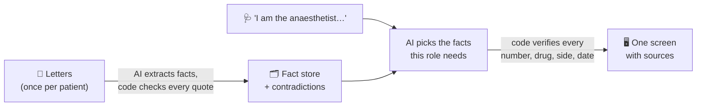
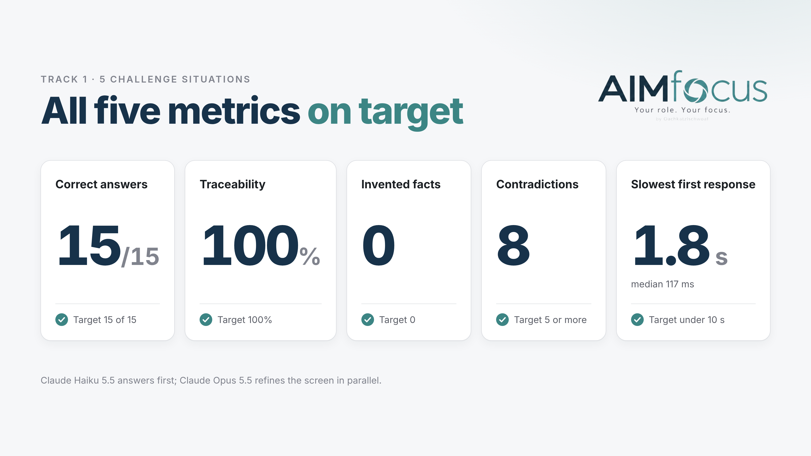

# AIMfocus

**Your role. Your focus.** – Team Oachkatzlschwoaf · IBM AIM Hackathon · Track 1: Clinical Documentation

AIMfocus gives every clinician one screen with exactly the patient facts their task needs –
and shows where each fact comes from. You say who you are and what you are about to do
(*"Anaesthetist, pre-op check before the breast operation"*), pick the patient, and within
about five seconds you see her blood thinner and dose, her contrast-media allergy and her last
heart ultrasound – each linked to the sentence in the letter it came from. The tumour's
receptor status is left out, because it does not matter for anaesthesia.

## The problem

A patient's story is spread over many letters: discharge summaries, outpatient letters,
radiology and pathology reports, written by different departments over months. For our
challenge patient that is eight German documents from 2015 and 2016.

- **Everyone needs something different.** The anaesthetist needs blood thinners, allergies
  and heart function. The surgeon needs the tumour stage and the tumour board's recommendation.
  The GP needs diabetes drugs, HbA1c and weight. Tools that list *everything* about a patient
  leave the clinician to dig out the few facts that matter right now.
- **Time is short.** Reading eight letters before every decision is not realistic, so
  important details get missed.
- **The records contradict themselves.** Copy-pasted text with left and right swapped, a BMI
  that does not match the height and weight in the same letter, a discharge date that cannot
  exist. These go unnoticed when nobody reads everything side by side.
- **AI summaries are hard to trust.** A fluent summary that invents a dose is worse than no
  summary. A clinician has to be able to check every fact in one click.

## Our solution

AIMfocus reads the whole record carefully **once**, ahead of time, and then builds a
role-specific screen in seconds – with three promises:

1. **Focused.** Only what this role needs for this task, ordered by urgency: *critical* (check
   before acting), *important* (for this task), *background* (context, collapsed).
2. **Traceable.** Every value links to the sentence or table row it comes from, shown
   highlighted in its letter. No source, no fact.
3. **Honest.** If the task needs something the letters do not contain, the screen says
   **"not documented"** instead of guessing. Contradictions between letters are flagged on the
   values they affect, with links to every passage involved.

### How it works, in plain words



1. **Read once, thoroughly.** Before anyone asks, an AI model reads every letter and writes
   down each fact – diagnosis, drug and dose, measurement, finding – together with the exact
   words it comes from. Code throws away any fact whose words are not really in the letter.
   It also calculates values such as weight change, BMI and current daily doses, and runs
   rule-based checks for contradictions.
2. **Pick, don't write.** When a clinician asks, a fast AI model only *chooses* which facts
   the role needs. It never types a value itself – values, units, dates and sources are copied
   from the fact store by code. For anything the fact store does not cover, a second search
   reads the letters directly and must quote them word for word.
3. **Check everything.** Before a fact reaches the screen, code checks that every number,
   drug name, side (left/right) and date really appears in the cited source. What fails is
   dropped or clearly marked "check".

Under the hood: a **Vue** frontend, a **FastAPI** core service, an offline preprocessing
pipeline, a rule-based contradiction finder and a **FHIR R4** patient store. Screens and chat
use **Claude Haiku 5.5** (fast) and **Claude Opus 5.5** (a more thorough screen that replaces
the fast one a few seconds later); offline fact extraction uses Gemini by default.
→ Details: [Technical architecture](docs/architecture.md)

## Features

**Telling AIMfocus what you need**
- Free text in your own words, or **voice input** – any role, any task, not a fixed menu
- Rotating example prompts and a list of recent sessions to jump back to
- Work starts the moment you submit: the screen is planned while you are still picking the
  patient, so picking her needs no extra AI call
- Patient search by name, ID or date of birth

**The screen**
- Ordered by urgency: critical, important, background
- The right form for each fact: single values, **trend charts** (weight, HbA1c, blood
  pressure …), tables (medication with dose, schedule and since when), lists (findings,
  diagnoses, recommendations) and **medical images**
- Patient header with name, age, allergies (CAVE), height, weight and BMI
- "As of" date: present tense means the date of the latest letter, not today
- **"Not documented"** when the letters do not answer a need
- Fills in live: documented facts first, then the results of the letter search, then the more
  thorough Opus screen
- Works on a phone

**Trust**
- A source icon on every value: the passage highlighted inside its letter section, one click
  further the whole letter with the passage scrolled into view
- **Contradictions** marked on the values they affect, with a summary and every linked passage;
  contradictions elsewhere in the record listed below the screen
- Tags for values found by searching the letter text ("from text") and for answers that failed
  verification ("check")

**Follow-up questions**
- A chat bar under the screen: ask anything about the patient and get a short answer in about
  two seconds, with sources, plus up to two extra cards rendered like the screen
- Follow-up questions keep the conversation context; English questions get English answers,
  German questions German ones

**Beyond the challenge**
- **More patients:** synthetic FHIR R4 records (Synthea / MITRE Coherent) are imported
  without any AI call; every feature works for them
- **Medical images:** DICOM studies with a three-plane preview and a scrollable slice viewer
- **Standards:** each patient's data is stored as one FHIR R4 bundle with ICD-10-GM, ATC and
  LOINC codes, validated with the official HL7 validator (0 errors); a `/stats` page shows the
  validated patients and documents

## Results

Measured on the challenge's 5 situations (details and method:
[Evaluation](docs/evaluation.md)). Accuracy on the screen after the Opus upgrade, speed on
the Haiku screen.



| Metric | Result | Target |
|---|---|---|
| Correct answers | **15 of 15** | 15 of 15 |
| Traceability | **100%** of linked sources (278/278) | 100% |
| Invented facts | **0** – nothing dropped or marked "check" by the validator | 0 |
| Contradictions | **8** real ones, no false alarms (checked by hand) | 5 or more |
| First response after picking the patient | **1.8 s** slowest, median 117 ms (in the app) | under 10 s |

To prepare for the jury's new situations we wrote 26 more (pharmacist, ward nurse, dentist,
radiologist, clinical coder, …): 76 of their 78 questions answered on the screen after the
Opus upgrade, 90–91 of all 93.

## What works and what doesn't (yet)

- ✅ End to end on the 5 challenge situations and on new roles and tasks for the same patient
- ✅ Every fact on screen is sourced; nothing unverified is shown as fact
- ⚠️ The Opus screen replaces the fast one a few seconds later, so cards can still change while you read
- ⚠️ A role-specific screen does not show every detail; specific questions outside the role's
  needs are answered by the chat
- ⚠️ Prototype limits: sessions live in memory in one process; a new letter means re-running the
  roughly two-minute preprocessing for that patient
- ⚠️ Voice input needs a browser with the Web Speech API (Chrome, Edge, Safari)

## Try it

You need Python 3.12+, Node 20+, an Anthropic API key, and the challenge's `data/` folder
copied to the repository root (IBM's data is not part of this repository).

From the repository root:

```bash
echo "CLAUDE_API_KEY=..." > .env          # + GOOGLE_API_KEY=... to build the fact store with Gemini
cd core && python3 -m venv .venv && .venv/bin/pip install -r requirements.txt
.venv/bin/python -m preprocess.run --patient 0000-0001     # once, about 2 minutes
.venv/bin/python -m uvicorn app.main:app --port 8001
```

In a second terminal, from the repository root:

```bash
cd frontend && npm install && npm run dev                   # → http://localhost:5173
```

Full instructions, optional steps and tests: [Getting started](docs/getting-started.md).

## Documentation

| Document | For |
|---|---|
| [Getting started](docs/getting-started.md) | Setup, running, importing more patients, tests, troubleshooting |
| [Technical architecture](docs/architecture.md) | Components, offline pipeline, runtime, validation, models, data |
| [Evaluation](docs/evaluation.md) | Metrics, the contradictions found, how to rerun the evaluation |
| [Core service](core/README.md) | Backend layout, API routes, configuration |
| [Frontend](frontend/README.md) | Views and components |
| [Screen and chat API](core/docs/screen-api.md) | JSON reference for screens, sources, contradictions, chat, images |
| [Contradiction finder](core/contradictions/README.md) | Detectors, LLM layer, results |
| [FHIR store](core/docs/fhir-plan.md) | FHIR R4 mapping, codes, validation results |

## Repository layout

| Path | What |
|---|---|
| `frontend/` | Vue app: situation input, patient search, result screen, chat |
| `core/` | FastAPI service, preprocessing pipeline, contradiction finder, validator, FHIR layer, tests, evaluation |
| `docs/` | Architecture, getting started, evaluation |
| `streams/` | Recorded screens to demo the dashboard without the AI (gitignored) |
| `data/` | The challenge data – copy it here yourself; never committed |

---

*Oachkatzlschwoaf* is Bavarian for "squirrel's tail" – famously hard to pronounce. The squirrel
chasing an acorn while the screen loads is ours too.
