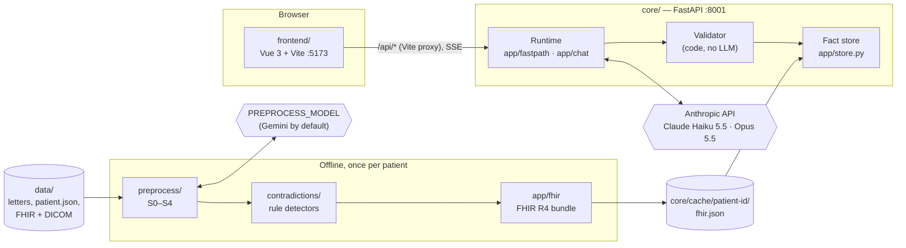
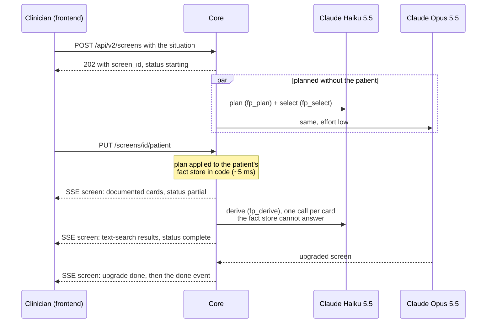

# Technical architecture

How AIMfocus turns eight German clinical letters into one role-specific, fully sourced
screen in about five seconds. For the product view, see the [README](../README.md).

**Core principle: slow and thorough offline, fast and constrained at runtime.** Everything
that needs careful reading of the letters happens once per patient, ahead of time. At
request time the model only *chooses* from facts that were already extracted and checked; it
never writes a value that code cannot trace back to a passage.

## Components

| Component | Path | What it does |
|---|---|---|
| Frontend | [`frontend/`](../frontend/README.md) | Vue 3 single-page app: situation input (text or voice), patient search, the result screen, source and contradiction popovers, chat. Chart.js for trends |
| Core API | [`core/app/`](../core/README.md) | FastAPI service. Builds screens and chat answers, serves letters, passages, original files, patient headers and images |
| Preprocessing | `core/preprocess/` | Offline pipeline S0–S4: split letters into passages, extract facts with an LLM, derive timelines and calculated values, export |
| Contradiction finder | [`core/contradictions/`](../core/contradictions/README.md) | Deterministic detectors for passages that cannot all be true; optional LLM sweep and judge |
| FHIR layer | `core/app/fhir/` | Stores each patient's whole cache as one validated FHIR R4 `Bundle` (ICD-10-GM, ATC, LOINC codes). See [fhir-plan.md](../core/docs/fhir-plan.md) |
| Validator | `core/app/runtime/validator.py`, checks in `app/fastpath` and `app/chat` | Code-only checks that every number, drug, side and date shown is in the cited facts or passages |
| Evaluation | `core/eval/` | Runs the challenge situations and the team's own situations against a running core and scores the screens. See [evaluation.md](evaluation.md) |

## Offline: reading the record once

`python -m preprocess.run --patient 0000-0001` writes everything to `core/cache/<patient>/`.
For the challenge patient it takes about 1 min 40 s, most of it the parallel S1 calls.

| Stage | What it does | Main output |
|---|---|---|
| **S0** passages | HTML unescape, section detection, split into sentences, table rows and list items with character offsets; marks text copied from an earlier report | `documents.json`, `passages.json` |
| **S1** extraction | `PREPROCESS_MODEL` extracts atomic facts from every document in parallel (long letters in parts of 30 passages). Each fact must quote a span that is literally in its passage, or it is dropped. An alias step links concept keys across documents (`C:med:metformin`, `C:meas:lvef`, …, see `preprocess/vocab.py`) | `facts.raw.json`, `s1_report.json`, `s1_aliases.json` |
| **S2** merge + derive | In code: concepts, timelines, and derived facts – current medication, daily doses, dose changes, weight change, BMI, age on the reference date, follow-up status | `facts.json`, `concepts.json`, `derived.json` |
| **S3** contradictions | The rule detectors in `contradictions/` (dates, BMI arithmetic, sides, copied text, case numbers, …). An optional LLM sweep + judge runs with `python -m contradictions --llm` | `contradictions.json`, `contradictions_report.json` |
| **S4** export | A compact fact sheet (one line per fact) and a manifest with coverage | `fact_sheet.txt`, `manifest.json` |
| **FHIR** | The whole cache as one R4 `Bundle`, validated against the R4B models; the runtime reads only this file | `fhir.json` |

Patients from synthetic FHIR records (Synthea / MITRE Coherent) skip S1: their resources are
already coded, so `python -m preprocess.import_fhir` turns them into facts directly (under
a second per patient) and renders a PNG preview for each DICOM study. Each fact cites a
readable line in a generated "FHIR record" document, so sources work exactly as for letters.

## Runtime: building a screen

1. **Start before the patient is known.** When the situation is submitted the core returns a
   screen ID at once. Both models start in parallel: a *plan* of the screen without any
   patient data (which cards the role needs and how to recognise their facts: fact types,
   terms, measurement keys, derived facts – `app/fastpath/plan.py`, prompt `fp_plan.md`),
   and a *select* call for the default patient.
2. **Patient picked → no new LLM call.** `PUT /api/v2/screens/<id>/patient` applies the plan
   to that patient's fact store in code. The model chose *which* facts; the values, units,
   dates and sources come from the store (`app/fastpath/shape.py`). Each card gets a
   priority, a tier (`critical` – check before acting, `important` – for this task,
   `background` – context) and an output type (`value`, `trend`, `table`, `list`, `image`).
3. **Text search for the rest.** Cards the fact store cannot fill go to one `fp_derive` call
   each, in parallel over the raw passages. An answer counts only with verbatim quotes from
   existing passages; numbers must appear in the quotes. Otherwise the card says
   **not documented**.
4. **Upgrade.** The same screen is built with Claude Opus 5.5 in parallel. When it is done it
   replaces the fast screen under the same ID (`upgrade: running → done`). Load time is
   measured on the fast screen.
5. **Streaming.** The frontend receives whole screens over server-sent events
   (`/api/v2/screens/<id>/stream`): documented cards first, text-search results and the
   upgraded screen as they arrive. No diffs.
6. **Contradictions on the screen.** A contradiction is attached to a card only when a value
   shown on it is one of the contradiction's passages or concepts; all others are listed
   under "other contradictions in the record".

Screens and chats live in memory in a single process – enough for the prototype.

### Chat

`POST /api/v2/chat/stream` answers a follow-up question in about 2 s. The fixed part of the
prompt (rules, the fact store under short handles, the full text of all letters) is the same
for every question and is sent as a cached prefix, so a question costs little more than its
own tokens. The model names the facts and passages it used; code checks them the same way
as for screens and builds the sources. Alongside the text answer, up to two cards are built
through the same screen machinery and streamed in.

### "Now"

Present tense means the date of the latest document (15 April 2016 for the challenge
patient). The app always searches all documents; derived facts such as age and current
medication are computed on that reference date.

## Validation: code, not LLM

The rule is simple: if code cannot find it in the cited source, it is not shown as fact.

- Every cited fact or passage ID must exist.
- Every number in a shown value must appear in the cited fact or the quoted passage.
- Every drug name must belong to a cited fact (brand or generic name).
- Every side (left/right) must match the cited fact's laterality.
- Every date must match a cited fact's date at the stated precision.
- Quotes from the text search must be verbatim substrings of their passages.
- A "not documented" card cites nothing.

Items that fail are dropped, or shown with a **check** tag when an answer existed but could
not be verified. Values found by the text search carry a **from text** tag. Rejected items
are logged as a hallucination monitor.

## Models

| Step | Model | Setting |
|---|---|---|
| Screen plan, select, derive; chat | Claude Haiku 5.5, no thinking | `RUNTIME_MODEL`, `RUNTIME_THINKING_BUDGET=0` |
| Screen upgrade (streams in later) | Claude Opus 5.5, effort low | `UPGRADE_MODEL`, `UPGRADE_EFFORT`; empty = off |
| Offline fact extraction, optional contradiction sweep and judge | `PREPROCESS_MODEL` (Gemini by default; Claude possible, or answered from files with `--offline-llm`) | once per patient |
| Tests | Fake client with canned responses | `LLM_FAKE=true` |

`app/llm/client.py` routes each call by model name: `claude-*` to Anthropic, anything else to
Google. All prompts are versioned Markdown files in `core/app/llm/prompts/`:

| Prompt | Used for |
|---|---|
| `s1_extract`, `s1_alias`, `s2_followup` | Offline fact extraction and concept linking |
| `cx_sweep`, `cx_judge` | Optional LLM contradiction sweep and judge (`contradictions/llm.py`) |
| `s3_judge` | Judge of the earlier S3 (`preprocess/s3_contradictions.py`, kept with `--keep-s3`) |
| `fp_plan`, `fp_select`, `fp_derive` | Screen plan, card selection, text search |
| `chat` | Follow-up questions |
| `r1_planner`, `r2_answerer` | The earlier runtime (`POST /api/screen`), kept for comparison |

Model choice was measured, not guessed: Gemini flash models were faster (under 3 s) but
answered fewer questions correctly; Gemini models with more thinking reached 15/15 but took
10–14 s. Claude Haiku 5.5 without thinking gave the best balance. The measurements are kept
as comments in `core/app/config.py`.

## Data and storage

- **Facts** carry a type, a concept key, fields (value, unit, dose, …), a date, laterality,
  status, and the passage plus character span they come from.
- **Derived facts** (`D:*`) are computed in code from facts and list the facts they use
  (`inputs`) and the formula.
- **Contradictions** (`X:*`) link *all* their passages and the concepts involved.
- **Storage:** one FHIR R4 `Bundle` per patient (`cache/<patient>/fhir.json`): documents as
  `DocumentReference`, facts as `Condition`, `MedicationStatement`, `AllergyIntolerance`,
  `Procedure`, `Observation`, `ServiceRequest`, `Encounter`, contradictions as `DetectedIssue`. It passes the official HL7 validator with 0 errors.
  Details: [fhir-plan.md](../core/docs/fhir-plan.md).
- **Originals:** `app/originals.py` maps each normalized passage back to the character span in
  the delivered file, so the frontend can show the passage in the original letter.

## API

The frontend uses the `/api/v2` routes. The complete JSON reference – screen, card types,
sources, contradictions, chat, patient header, images – is
[core/docs/screen-api.md](../core/docs/screen-api.md); the route list is in
[core/README.md](../core/README.md#api). OpenAPI docs: `http://localhost:8001/docs`.
